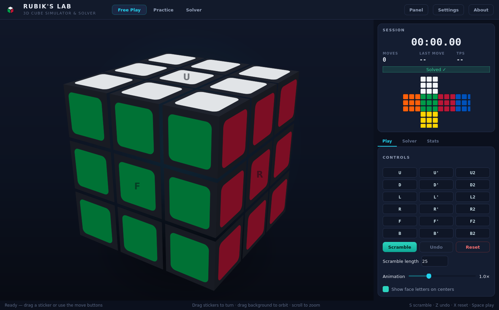
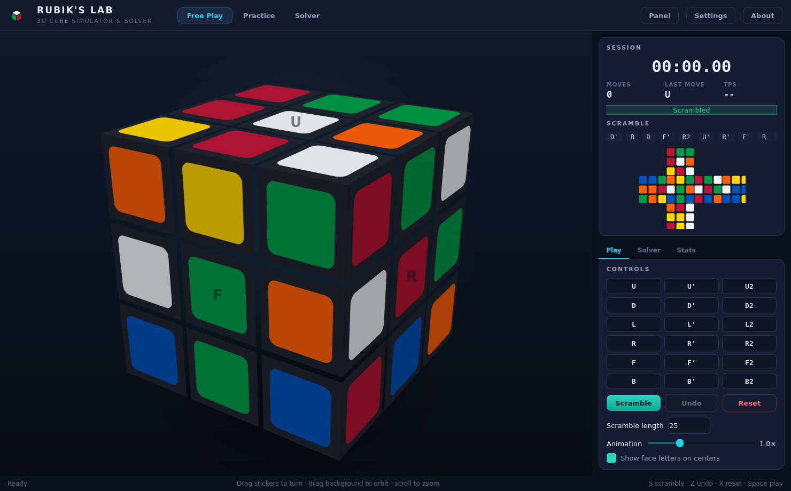
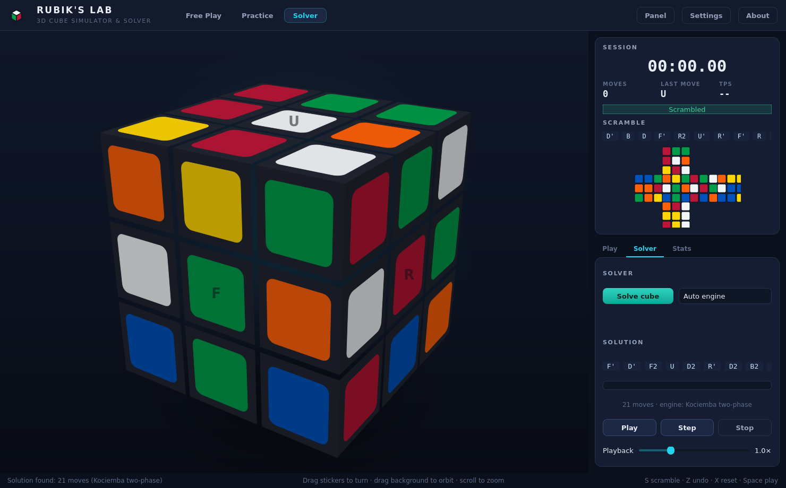
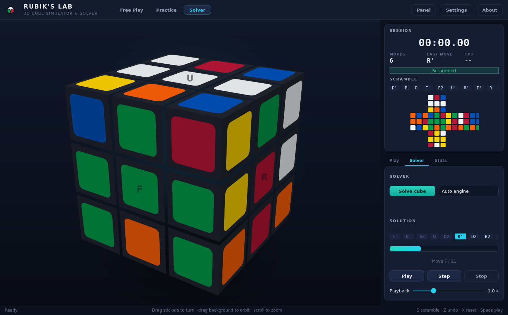
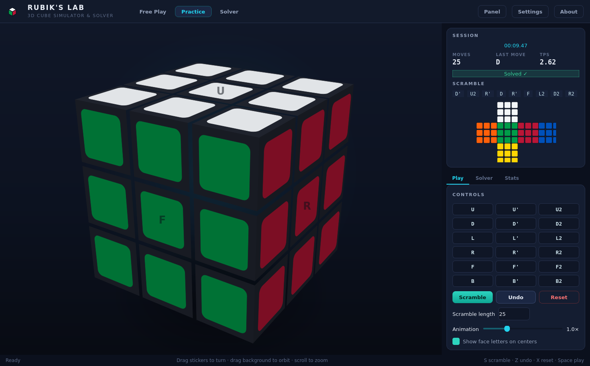
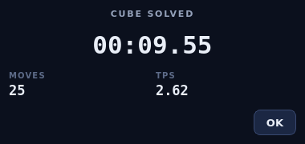
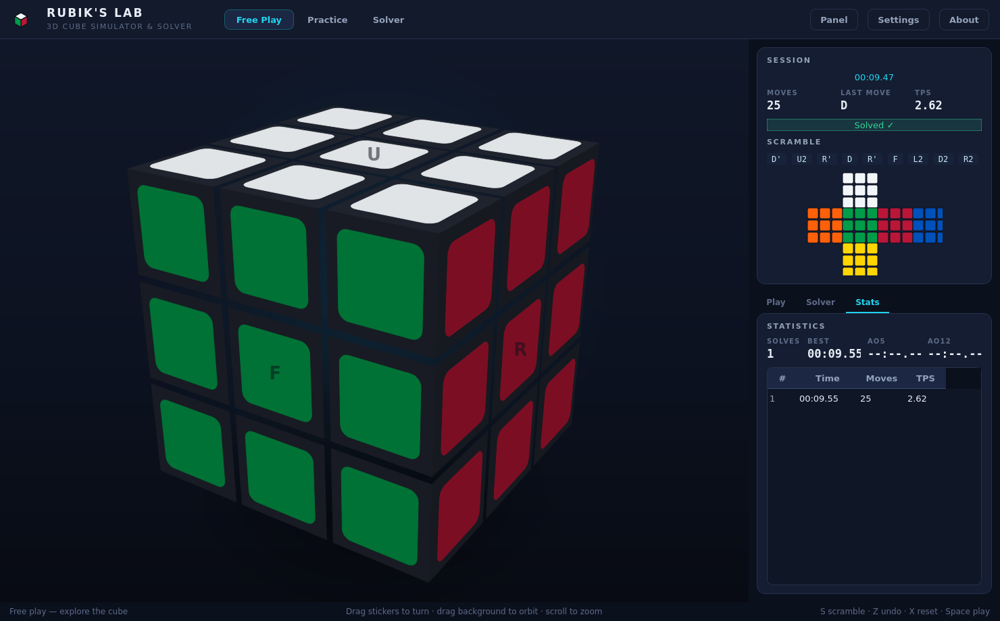
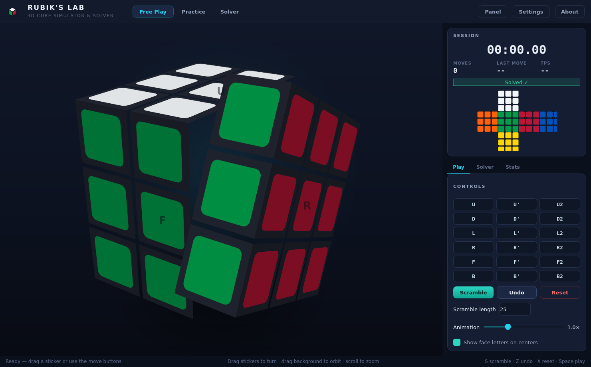

# RUBIK'S LAB 🎮🧊

[English](#english) | [العربية](#العربية)

---

## English

**A professional 3D Rubik's Cube simulator & solver for the desktop.**

RUBIK'S LAB is a polished, fully functional Python desktop application: an interactive 3D Rubik's Cube with animated face turns, mouse & keyboard control, WCA-style scrambles, a *real* automatic solver (Kociemba two-phase with a built-in pure-Python layer-by-layer fallback), a practice mode with timer and statistics — all wrapped in a carefully designed dark professional interface.

---

### Features

#### Cube & 3D workspace
- Exact logical 3×3×3 cube engine (26 cubies, integer math only — the logical state can never drift, and the visuals re-sync from it after every single move).
- Smooth animated face turns with a serial animation queue, easing and a configurable speed; moves never overlap and the visuals always land exactly on the 90°/180° position.
- Orbit camera with inertial easing (drag), wheel zoom, double-click to reset the view; Lambert + specular lighting and a soft contact shadow.
- **Drag a sticker to turn its layer** — the renderer picks the sticker under the cursor and matches your drag direction against the possible rotations, exactly like commercial cube simulators.
- Optional face letters on the center stickers (great for teaching).

#### Solving
- **Kociemba two-phase solver** (via the `kociemba` package): ~20-move solutions in milliseconds, computed in a background thread.
- **Built-in layer-by-layer engine** (pure Python, zero dependencies): a complete beginner-method solver — works on any valid state even if `kociemba` is not installed. Both engines solve the cube from its *current state*; neither reverses the move history.
- State validation before every solve (color counts, piece identity, orientation parity, permutation parity).
- Solution playback with **play / pause / resume / step / stop**, adjustable speed, progress bar and per-move highlighting.

#### Practice & statistics
- Practice mode: scramble → the timer starts on your first move → the app detects the solve and shows a completion screen (time, moves, TPS).
- Statistics with best time, mean, **ao5 / ao12** trimmed averages and a recent-solves table; persisted to `data/stats.json`.
- Move counter, last-move readout, live TPS, scramble display and a 2D unfolded cube net that is always in sync with the 3D view.

#### Interface
- Three modes: **Free Play**, **Practice**, **Solver**.
- Full 18-move control panel (`X`, `X'`, `X2` for all six faces), Scramble / Undo / Reset, scramble-length and animation-speed settings.
- Keyboard-first design: every action has a shortcut.
- Settings dialog (animation speed, scramble length, face letters, solver engine, statistics reset) persisted to `data/settings.json`.

---

### Screenshots

#### Overview — Free Play


#### Scrambled cube with scramble readout and 2D net


#### Solver mode — 22-move Kociemba solution ready for playback


#### Solution playback in progress


#### Practice mode


#### Practice completion


#### Statistics


#### Smooth mid-turn animation


---

### Installation

Requires **Python 3.11+** (3.12+ recommended).

```bash
cd rubiks-lab
python -m venv .venv
# Windows:  .venv\Scripts\activate
# Linux/macOS:
source .venv/bin/activate

pip install -r requirements.txt
```

---

### Running

#### Windows (One-Click Launcher)
Double-click `run.bat` or run from terminal:
```bat
run.bat
```

#### Manual (CLI)
```bash
python main.py
```

---

### Keyboard shortcuts

| Keys | Action |
| --- | --- |
| `U` `D` `L` `R` `F` `B` | Clockwise quarter turn of that face |
| `Shift` + face | Counter-clockwise turn (`X'`) |
| `Alt` + face | Half turn (`X2`) |
| `S` | Scramble |
| `Z` or `Ctrl+Z` | Undo last move |
| `X` | Reset cube to solved |
| `Space` | Play / pause solution playback |
| `→` | Step one move of the solution |
| `Esc` | Stop playback |
| `1` / `2` / `3` | Free Play / Practice / Solver mode |
| `F1` | About & shortcuts |
| Mouse drag on sticker | Turn that layer |
| Mouse drag on background / right-drag | Orbit camera |
| Wheel | Zoom · double-click resets camera |

---

### Architecture

```text
rubiks-lab/
├── dist/RubiksLab/          # standalone executable bundle (RubiksLab.exe)
├── main.py                  # entry point
├── run.bat                  # one-click Windows launcher (detects/installs venv)
├── build_windows.bat        # one-command Windows standalone exe build
├── requirements.txt         # runtime + dev dependencies
├── rubiks_lab.spec          # PyInstaller build recipe
├── دليل_التشغيل.md          # comprehensive user guide (Arabic + English)
├── assets/
│   ├── icons/               # application icon (png + ico)
│   └── screenshots/         # real screenshots used by this README
├── core/                    # the logical cube — pure Python, no Qt
│   ├── cube.py              #   CubeState: 26 cubies, integer math
│   ├── cubie.py             #   (Cubie lives in cube.py; see note)
│   ├── moves.py             #   Move model, exact rotation matrices,
│   │                        #   notation parsing, sequence tools
│   ├── cube_validator.py    #   legality checks (parity invariants)
│   └── scramble.py          #   WCA-style scramble generator
├── engine/                  # 3D presentation layer (PySide6 + numpy)
│   ├── camera.py            #   smooth orbit camera + projection
│   ├── animator.py          #   serial animation queue & lifecycle
│   ├── renderer.py          #   software 3D renderer (painter's alg.)
│   └── cube_view.py         #   interactive widget: input, hover,
│                            #   drag-to-turn, painting
├── solver/
│   ├── solver.py            # facade: Kociemba (optional) + fallback
│   ├── lbl_solver.py        # pure-Python layer-by-layer engine
│   └── solution_player.py   # solution playback controller
├── ui/
│   ├── main_window.py       # window, modes, session logic, dialogs
│   ├── panels.py            # control / info / solver / stats panels
│   ├── components.py        # cards, badges, cube net, chips, logo
│   └── themes.py            # QSS dark theme & palette tokens
├── services/
│   ├── settings.py          # JSON settings (data/settings.json)
│   └── statistics.py        # solve history + ao5/ao12 aggregation
└── tests/                   # 157 automated tests (see Testing)
```

---

### Solver explanation

`solver/solver.py` is a facade over two real engines. Both solve from the cube's current state only:

1. **Kociemba two-phase (`kociemba` package):**
   Herbert Kociemba's two-phase algorithm: phase 1 reduces the cube into the subgroup with oriented edges/corners; phase 2 solves the remainder. Runs in a background thread. Typical solutions: **18–22 moves**.
2. **Built-in layer-by-layer (`solver/lbl_solver.py`):**
   A complete beginner-method solver written in pure Python: D cross → D corners → Middle edges → Last layer (BFS tables). Verified programmatically. Typical solutions: **105–190 moves**.

---

### Testing

157 automated tests (pytest):

```bash
python -m pytest tests -q
```

| Suite | What it proves |
| --- | --- |
| `test_moves.py` | Each of the 18 moves has its documented effect; `X X'` restores; `X⁴` restores; `X2 X2` restores; notation round-trips; Unicode quotes/primes |
| `test_inverse_moves.py` | 300 random sequences + their inverse restore the solved cube; wrong-order undo does not; sexy-move order-6 identity |
| `test_cube_state.py` | Facelet derivation matches two independent readings; centers never move; validity preserved under random walks; corrupted states rejected |
| `test_scramble.py` | Length, no same-face-consecutive, no same-axis `A B A`, determinism with seed, never corrupts the cube, inverse restores |
| `test_solver.py` | **250 random states** solved & verified by the built-in engine; Kociemba solutions ≤ 24 moves and verified; invalid states rejected |
| `test_gui_smoke.py` | The real window offscreen: animation→logic pipeline, scramble, solve + playback, step, undo, reset, practice timing + statistics recording, settings persistence, drag matcher (CW & CCW), mode buttons |
| `test_services.py` | JSON-backed Settings & Statistics; WCA standard ao5 and ao12 trimmed averages; persistence & callbacks |

---

### Packaging (Windows executable)

```bat
build_windows.bat
```

Creates a standalone one-folder distribution in **`dist\RubiksLab\RubiksLab.exe`** with zero external dependencies.

---
---

## العربية

**محاكي وحلال مكعب روبيك ثلاثي الأبعاد احترافي لسطح المكتب.**

تطبيق **RUBIK'S LAB** هو برنامج متكامل مبني بلغة Python: مكعب روبيك تفاعلي ثلاثي الأبعاد مع حركات دوران سلسة ومتحركة، تحكم كامل عبر الفأرة ولوحة المفاتيح، خلط عشوائي متوافق مع معايير WCA، **محرك حل حقيقي وتلقائي** (خوارزمية Kociemba ثنائية المرحلة مع محرك احتياطي مدمج لحل الطبقات بلغة بايثون الخالصة)، وضع تدريب مع مؤقت ذكي وإحصائيات متقدمة، كل ذلك بواجهة داكنة عصرية واحترافية.

---

### المميزات الرئيسية

#### بيئة المكعب ثلاثية الأبعاد
- محرك منطقي دقيق 3×3×3 (26 مكعباً صغيراً مع عمليات حسابية صحيحة بنسبة 100% بدون أي انحراف في الإحداثيات).
- حركة دوران متحركة وسلسة مع طابور زمني يضمن عدم تداخل الحركات وهبوط الأوجه بدقة 90° و 180°.
- كاميرا مدارية ناعمة مع تخميد القصور الذاتي، تكبير وتصغير بالدولاب، ونقر مزدوج لإعادة ضبط الزاوية مع إضاءة وظلال واقعية.
- **إمكانية سحب أي ملصق لتدوير طبقته** مباشرة بالفأرة في الاتجاهين (مع وعكس عقارب الساعة).
- أحرف توضيحية اختيارية على ملصقات المراكز للمساعدة في التعلم.

#### محركات الحل التلقائي
- **محرك Kociemba ثنائي المرحلة:** يجد حلولاً خارقة وقصيرة تتراوح بين **18 إلى 22 حركة فقط** في أجزاء من الثانية، ويعمل في خيط خلفي للحفاظ على سلاسة الواجهة.
- **المحرك الطبقي المدمج (LBL):** مبني بالكامل ببايثون النقية (بدون أي مكتبات خارجية)، يحل أي مكعب بطريقة المبتدئين خطوة بخطوة.
- فحص قانونية المكعب قبل كل حل والتأكد من صحة عدد الألوان والتناظر.
- مشغل حلول متطور مع أزرار: **تشغيل / إيقاف مؤقت / تقديم خطوة / إيقاف**، مع شريط تقدم وتظليل الحركات الحالية.

#### التدريب والإحصائيات
- **وضع التدريب:** خلط المكعب ثم بدء المؤقت تلقائياً عند أول حركة للمستخدم، مع الكشف عن الحل وعرض بطاقة الإنجاز (الوقت، عدد الحركات، وسرعة TPS).
- إحصائيات متقدمة وفق المعايير الدولية لسبيد كيوبنج (**أفضل وقت، المتوسط العام، معدلات ao5 و ao12 المحذوفة**).
- عداد الحركات، قراءة آخر حركة، معدل الحركات في الثانية المباشر، وشبكة مكعب مسطحة 2D متزامنة لحظياً مع المشهد ثلاثي الأبعاد.

#### واجهة المستخدم
- 3 أوضاع رئيسية: **اللعب الحر (Free Play)**، **التدريب (Practice)**، و**المحلل (Solver)**.
- لوحة تحكم كاملة بـ 18 حركة، مع أزرار الخلط والتراجع وإعادة التعيين.
- دعم كامل للاختصارات من لوحة المفاتيح.
- نافذة إعدادات لحفظ سرعة الحركة، طول الخلط، وتفضيلات المحرك في `data/settings.json`.

---

### لقطات الشاشة

#### الواجهة العامة — وضع اللعب الحر


#### المكعب بعد الخلط مع نص الخوارزمية والشبكة الثنائية


#### وضع الحل — حل Kociemba في 22 حركة جاهز للتشغيل


#### تشغيل وعرض خطوات الحل


#### وضع التدريب


#### بطاقة اكتمال الحل في وضع التدريب


#### نافذة الإحصائيات وجدول الجولات


#### حركة الدوران السلسة


---

### التثبيت ومتطلبات التشغيل

يتطلب **Python 3.11 أو أحدث** (يفضل 3.12+).

```bash
cd rubiks-lab
python -m venv .venv
# على ويندوز:  .venv\Scripts\activate
# على لينكس / ماك:
source .venv/bin/activate

pip install -r requirements.txt
```

---

### طرق التشغيل

#### على نظام Windows (بنقرة واحدة)
اضغط ضغطتين على ملف `run.bat` أو نفذ من الطرفية:
```bat
run.bat
```

#### التشغيل اليدوي
```bash
python main.py
```

---

### اختصارات لوحة المفاتيح

| المفتاح | الوظيفة |
| --- | --- |
| `U` `D` `L` `R` `F` `B` | تدوير الوجه ربع دورة مع عقارب الساعة |
| `Shift` + الحرف | تدوير الوجه عكس عقارب الساعة (`X'`) |
| `Alt` + الحرف | نصف دورة 180 درجة (`X2`) |
| `S` | خلط المكعب عشوائياً |
| `Z` أو `Ctrl+Z` | التراجع عن الحركة الأخيرة |
| `X` | إعادة ضبط المكعب لوضع الحل |
| `Space` (مسطرة) | تشغيل / إيقاف مؤقت لحركات الحل |
| `→` (سهم يمين) | تنفيذ خطوة واحدة من الحل |
| `Esc` | إيقاف تشغيل الحل |
| `1` / `2` / `3` | التبديل بين الأوضاع (حر / تدريب / محلل) |
| `F1` | نافذة حول البرنامج والاختصارات |
| سحب الملصق بالماوس | تدوير الطبقة المحددة مباشرة |
| سحب الخلفية بالزر الأيمن | تدوير زاوية الكاميرا في الفضاء ثلاثي الأبعاد |
| دولاب الماوس | تقريب وتبعيد الكاميرا (Zoom) |

---

### بنية المشروع

```text
rubiks-lab/
├── dist/RubiksLab/          # النسخة التنفيذية المستقلة الجاهزة (RubiksLab.exe)
├── main.py                  # نقطة الدخول الرئيسية للتطبيق
├── run.bat                  # مشغل الويندوز التلقائي بنقرة واحدة
├── build_windows.bat        # سكريبت بناء ملف EXE المستقل
├── requirements.txt         # متطلبات ومكتبات التشغيل
├── rubiks_lab.spec          # ملف تكوين حزمة PyInstaller
├── دليل_التشغيل.md          # الدليل الإرشادي المزدوج (عربي وإنجليزي)
├── assets/
│   ├── icons/               # أيقونات التطبيق (png و ico)
│   └── screenshots/         # لقطات شاشة حقيقية للبرنامج
├── core/                    # المنطق البرمجي للمكعب (بايثون نقي بدون واجهة)
│   ├── cube.py              #   حالة المكعب والقطع الحسابية (CubeState)
│   ├── cubie.py             #   بيانات المكعبات الفردية
│   ├── moves.py             #   مصفوفات الدوران وقراءة خوارزميات الحركات
│   ├── cube_validator.py    #   فحص صحة وقانونية حالة المكعب
│   └── scramble.py          #   مولد خلطات WCA المعتمدة
├── engine/                  # طبقة العرض والرسوميات ثلاثية الأبعاد (Qt6 + numpy)
│   ├── camera.py            #   كاميرا مدارية سلسة مع الإسقاط المنظوري
│   ├── animator.py          #   طابور الرسوم المتحركة وإدارة الحركة
│   ├── renderer.py          #   المصير البرمجي ثلاثي الأبعاد (خوارزمية الرسام)
│   └── cube_view.py         #   ويدجت العرض التفاعلي وسحب الملصقات
├── solver/
│   ├── solver.py            # واجهة المحللات (Kociemba والمحرك المدمج)
│   ├── lbl_solver.py        # محرك الحل الطبقي الكامل للمبتدئين
│   └── solution_player.py   # متحكم تشغيل خطوات الحل
├── ui/
│   ├── main_window.py       # النافذة الرئيسية، الأوضاع، والنوافذ المنبثقة
│   ├── panels.py            # لوحات التحكم، الجلسة، المحلل، والإحصائيات
│   ├── components.py        # البطاقات، الأوسمة، شبكة المكعب 2D، والشعار
│   └── themes.py            # تنسيقات الواجهة الداكنة (QSS) ولوحة الألوان
├── services/
│   ├── settings.py          # حفظ الإعدادات في (data/settings.json)
│   └── statistics.py        # سجل أوقات الحل وحساب معدلات ao5/ao12
└── tests/                   # 157 اختباراً آلياً مؤتمتاً
```

---

### الاختبارات المؤتمتة (Tests)

يحتوي المشروع على **157 اختباراً شاملاً** عبر مكتبة `pytest`:

```bash
python -m pytest tests -q
```

| ملف الاختبار | ما يثبته ويتحقق منه |
| --- | --- |
| `test_moves.py` | صحة جميع الحركات الـ 18، استعادة الحالة عبر المعكوس، دورات الحركة، قراءة الرموز الموحدة واقتباسات يونيكود |
| `test_inverse_moves.py` | اختبار 300 تسلسل عشوائي مع معكوساتها، وإثبات تطابقات الحركات الشهيرة (مثل Sexy move) |
| `test_cube_state.py` | مطابقة قراءة الملصقات، ثبات المراكز، الحفاظ على الصلاحية، ورفض الحالات المستحيلة والتالفة |
| `test_scramble.py` | الالتزام بقواعد الخلط الرسمية لـ WCA، منع تكرار الوجه نفسه أو المحور المتتالي، وتناسق الخلط |
| `test_solver.py` | **حل 250 حالة عشوائية** بالكامل عبر محرك LBL، حلول Kociemba في 24 حركة أو أقل، ورفض الحالات غير القانونية |
| `test_gui_smoke.py` | اختبار حقيقي للواجهة خارج الشاشة: الرسوم، الخلط، الحل، التشغيل، التراجع، الأزرار، والسحب بالاتجاهين |
| `test_services.py` | فحص حفظ واسترجاع الإعدادات وسجل الإحصائيات، وصحة حساب معدلات ao5 و ao12 القياسية |

---

### بناء النسخة المستقلة (Windows EXE)

```bat
build_windows.bat
```

ينتج مجلداً مستقلاً بالكامل داخل **`dist\RubiksLab\RubiksLab.exe`** يعمل على أي كمبيوتر ويندوز دون الحاجة لتثبيت بايثون أو أي مكتبات.
